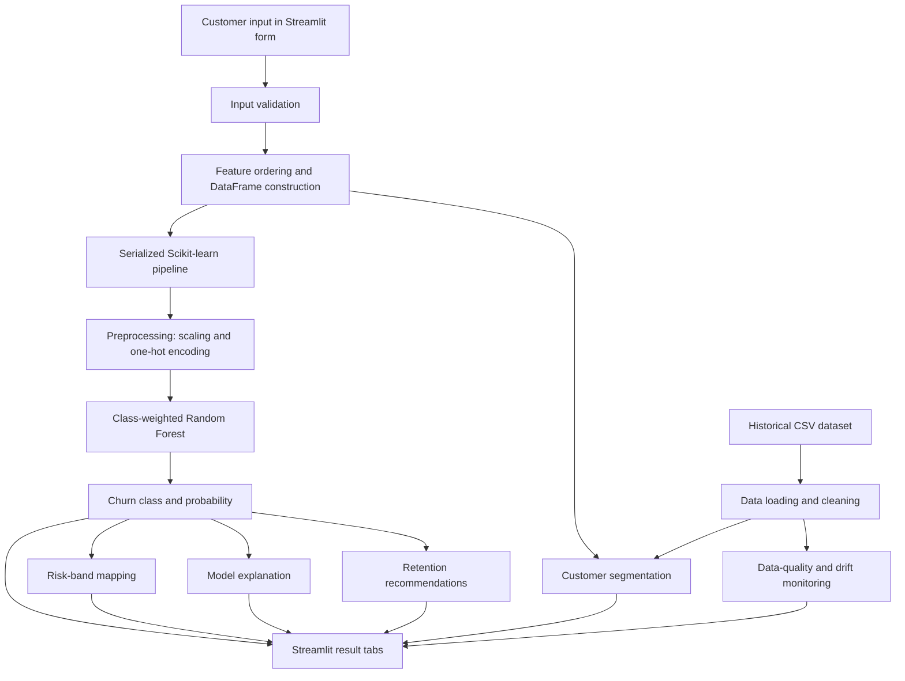

# Customer Churn Prediction: Project Architecture and File Structure

## 1. System overview

The project is an explainable telecom customer churn prediction and retention decision-support system. It combines a trained machine-learning pipeline, reusable Python modules, a Streamlit user interface, evaluation utilities, monitoring functions, and automated tests.

The system receives customer demographic, account, service, contract, billing, and payment information. It validates the input, applies the same preprocessing used during training, generates a churn probability and class prediction, maps the probability to a provisional risk band, and presents supporting explanations and recommendations.

The project is organized into five logical layers:

| Layer | Responsibility | Main locations |
|---|---|---|
| Data layer | Stores the source customer dataset used for analysis and reference monitoring. | `data/` |
| Model layer | Stores the serialized Scikit-learn preprocessing and Random Forest pipeline. | `models/` |
| Application layer | Provides the interactive user interface and coordinates prediction, explanation, recommendations, segmentation, performance, and monitoring. | `app.py` |
| Service and analytics layer | Contains reusable functions for data loading, prediction, explanations, recommendations, segmentation, monitoring, and optional AI summaries. | `src/` |
| Quality layer | Validates model serving, input validation, explanation output, recommendations, segmentation, and monitoring behavior. | `test_*.py` |

## 2. High-level architecture



## 3. End-to-end data flow

The system follows the sequence below.

| Step | Process | Result |
|---:|---|---|
| 1 | A user enters customer characteristics through the Streamlit sidebar form. | Raw customer input dictionary. |
| 2 | The prediction module checks required fields, numeric types, numeric ranges, and allowed categorical values. | Validated customer record or a clear validation error. |
| 3 | The record is converted to a one-row Pandas DataFrame in the model’s expected feature order. | Model-ready input table. |
| 4 | The serialized pipeline applies the training-time transformations. | Scaled numeric values and one-hot encoded categorical values. |
| 5 | The Random Forest produces a class prediction and churn probability. | `prediction` and `probability`. |
| 6 | The probability is mapped to a provisional risk band. | Low, Medium, or High. |
| 7 | Supporting modules calculate feature explanations and rule-based recommendations. | Factors and recommended investigation actions. |
| 8 | The Streamlit application renders the results. | Interactive decision-support view. |

## 4. Machine-learning architecture

### 4.1 Input features

The model uses four numeric features:

- `SeniorCitizen`
- `tenure`
- `MonthlyCharges`
- `TotalCharges`

It uses categorical features covering gender, household characteristics, phone service, multiple lines, internet service, security and backup add-ons, device protection, technical support, streaming services, contract type, paperless billing, and payment method.

The `customerID` column is excluded because it is an identifier rather than a behavioral feature. The target is `Churn`, mapped from `Yes` and `No` to binary values.

### 4.2 Preprocessing pipeline

The model uses a `ColumnTransformer` with two branches:

```text
Numeric columns
    → StandardScaler

Categorical columns
    → OneHotEncoder(handle_unknown="ignore")
```

The transformer is placed inside the same Scikit-learn `Pipeline` as the classifier. This design ensures that preprocessing is learned from the training data and reused consistently during testing and deployment.

### 4.3 Classification model

The classifier is a class-weighted Random Forest:

```python
RandomForestClassifier(
    n_estimators=300,
    max_depth=10,
    random_state=42,
    class_weight="balanced",
)
```

The model was selected because it is appropriate for tabular business data, can represent nonlinear relationships and interactions, supports class weighting for class imbalance, and provides feature-importance information.

### 4.4 Prediction output

The prediction service returns the following structure:

| Field | Meaning |
|---|---|
| `prediction` | Binary predicted class generated by the classifier. |
| `probability` | Estimated probability of the positive churn class. |
| `risk_band` | Presentation label derived from probability thresholds. |

The current provisional risk bands are:

| Probability interval | Risk band |
|---:|---|
| `< 0.30` | Low |
| `0.30` to `< 0.60` | Medium |
| `≥ 0.60` | High |

These thresholds are interface labels and should be recalibrated before operational use.

## 5. Application architecture

`app.py` is the Streamlit entry point. It configures the page, loads the serialized model, derives the expected schema, creates the input form, and coordinates the result tabs.

The application exposes the following functional areas:

| Interface area | Function |
|---|---|
| Prediction | Displays churn probability, predicted class, risk band, probability gauge, and customer-input summary. |
| Explanation | Displays supporting model factors for the individual prediction. |
| Recommended Actions | Provides rule-based retention investigation suggestions with reasons and priorities. |
| Segments | Fits and profiles customer segments using selected numeric variables. |
| Model Performance | Displays model-comparison metrics when a generated comparison file is available. |
| AI Summary | Optionally converts verified prediction facts into a plain-language business summary through Ollama or an explicitly configured OpenAI-compatible service. |
| Monitoring | Reports reference-data quality and supports drift/performance monitoring utilities. |

The application uses `st.cache_resource` to avoid repeatedly loading the serialized model during the Streamlit session.

## 6. File and directory structure

```text
Customer-Churn-Prediction/
├── Customer_Churn_Project.ipynb
├── README.md
├── PROJECT_ARCHITECTURE.md
├── VIVA_TECHNICAL_QA.md
├── requirements.txt
│
├── app.py
│
├── data/
│   └── WA_Fn-UseC_-Telco-Customer-Churn.csv
│
├── models/
│   └── churn_model.pkl
│
├── src/
│   ├── __init__.py
│   ├── ai_summary.py
│   ├── explain.py
│   ├── metrics.py
│   ├── monitoring.py
│   ├── predict.py
│   ├── recommendations.py
│   └── segmentation.py
│
├── test_explain_and_recommendations.py
├── test_predict.py
└── test_segmentation_monitoring.py
```

## 7. File-by-file description

| File or directory | Description |
|---|---|
| `Customer_Churn_Project.ipynb` | Exploratory analysis, data preparation, train-test split, model training, classification report, ROC-AUC evaluation, confusion matrix, visualizations, and model serialization workflow. |
| `README.md` | Public project overview, setup instructions, modeling details, evaluation results, limitations, and responsible-use guidance. |
| `PROJECT_ARCHITECTURE.md` | This architecture and file-structure documentation for the project report. |
| `VIVA_TECHNICAL_QA.md` | Likely technical viva questions and project-specific answers. |
| `requirements.txt` | Python dependencies required for the application, machine-learning workflow, explainability, optional AI summaries, and tests. Scikit-learn is pinned to `1.7.2` to match the serialized model’s training version. |
| `app.py` | Streamlit user interface and orchestration layer. |
| `data/WA_Fn-UseC_-Telco-Customer-Churn.csv` | Historical telecom customer dataset used for training, analysis, segmentation, and reference monitoring. |
| `models/churn_model.pkl` | Serialized Scikit-learn pipeline containing the preprocessing transformer and Random Forest classifier. |
| `src/__init__.py` | Marks `src` as a Python package. |
| `src/ai_summary.py` | Builds verified prediction facts and optionally generates a structured business summary using a local Ollama service or an explicitly configured OpenAI-compatible service. |
| `src/explain.py` | Produces model-factor explanations for an individual prediction using the fitted model and SHAP-related utilities. |
| `src/metrics.py` | Loads and cleans the dataset, builds candidate estimators, performs cross-validation, and evaluates alternative probability thresholds. |
| `src/monitoring.py` | Provides data-quality summaries, numeric-drift calculations, and labeled performance metrics at a selected threshold. |
| `src/predict.py` | Loads the model, extracts the model schema, validates customer input, predicts churn, and assigns the risk band. |
| `src/recommendations.py` | Generates rule-based retention recommendations based on customer input, churn probability, and explanation output. |
| `src/segmentation.py` | Uses scaled KMeans clustering and silhouette scores to select and profile analytical customer segments. |
| `test_predict.py` | Tests prediction output, missing-field handling, invalid charges, invalid categories, and impossible tenure values. |
| `test_explain_and_recommendations.py` | Tests explanation output columns and recommendation reasons and priorities. |
| `test_segmentation_monitoring.py` | Tests segmentation, segment profiling, data-quality summaries, and labeled performance metrics. |

## 8. Module responsibilities

### `app.py`

This is the presentation and orchestration layer. It should remain relatively thin: it collects inputs, calls reusable functions from `src`, and renders results. Business logic is kept in separate modules so that it can be tested independently of Streamlit.

### `src/predict.py`

This is the model-serving layer. It is responsible for model loading, schema discovery, validation, probability prediction, class prediction, and risk-band conversion. It is the primary interface between the application and the serialized model.

### `src/metrics.py`

This is the evaluation layer. It supports dataset loading, preprocessing construction, candidate model construction, stratified cross-validation, and threshold analysis. It is useful for comparing a baseline, logistic regression, Random Forest, and gradient boosting models.

### `src/explain.py` and `src/recommendations.py`

These modules provide decision-support features around the core prediction. Explanations identify influential model factors, while recommendations convert selected customer and model signals into rule-based investigation suggestions. Neither module should be interpreted as proving causation.

### `src/segmentation.py` and `src/monitoring.py`

These modules extend the system beyond one-customer prediction. Segmentation groups customers for exploratory analysis, while monitoring summarizes reference-data quality, numeric drift, and labeled predictive performance.

### `src/ai_summary.py`

This is an optional language-model integration layer. It receives verified facts from the prediction, explanation, and recommendation layers. It is designed to summarize existing facts and not to invent customer history, causes, or unsupported metrics.

## 9. Deployment architecture

The deployment path is:

```text
GitHub repository
      ↓
Streamlit Cloud build
      ↓
requirements.txt dependency installation
      ↓
app.py execution
      ↓
src package imports
      ↓
models/churn_model.pkl loading
      ↓
Interactive Streamlit application
```

The repository layout is deployment-safe because the import paths and file paths are consistent:

```text
from src.predict import ...
ROOT / "models" / "churn_model.pkl"
ROOT / "data" / "WA_Fn-UseC_-Telco-Customer-Churn.csv"
```

The Scikit-learn version is pinned because serialized estimator objects can be sensitive to library-version differences. The model should be retrained and reserialized when major dependency changes are introduced.

## 10. Testing architecture

The project uses Pytest for unit-level validation. Tests are organized around behavior rather than interface rendering:

```text
Prediction service tests
    → output range and risk band
    → missing field validation
    → numeric range validation
    → categorical value validation

Explanation and recommendation tests
    → explanation columns
    → sorted explanation impact
    → recommendation reasons and priorities

Segmentation and monitoring tests
    → cluster selection and profiles
    → data-quality summary
    → ROC-AUC and PR-AUC output
```

This structure makes it possible to verify the core logic without requiring a browser session. Streamlit startup can then be smoke-tested separately.

## 11. Report-ready architecture description

The proposed system follows a modular layered architecture. The raw telecom customer data is stored in the data layer, while the trained preprocessing and classification pipeline is stored in the model layer. The application layer is implemented using Streamlit and acts as the user-facing entry point. Reusable machine-learning and analytics functions are placed in the `src` package, which separates model-serving logic from presentation logic. The testing layer validates input handling, predictions, explanations, recommendations, segmentation, and monitoring behavior.

When a user submits a customer record, the application validates the values against the model schema. The validated record is converted into the expected feature order and passed to the serialized Scikit-learn pipeline. The pipeline applies numerical scaling and categorical one-hot encoding before passing the transformed data to the class-weighted Random Forest classifier. The application then displays the churn probability, predicted class, and provisional risk band. Additional modules provide explanations, recommendations, customer segmentation, and monitoring information.

This architecture improves maintainability because individual responsibilities are separated into modules. It also improves reproducibility because the preprocessing transformer and classifier are saved together. Finally, it supports responsible use by presenting the model as decision support with explanations, validation, testing, and explicit limitations rather than as an autonomous decision-maker.

## 12. Suggested future architecture improvements

For a production-oriented version, the repository could add a dedicated training script, a configuration file for paths and thresholds, a model metadata file, automated CI testing, a data-validation schema, batch-scoring support, experiment tracking, model-version tracking, probability calibration, temporal validation, drift alerts, and a model card. These additions would improve reproducibility, monitoring, governance, and maintainability.
